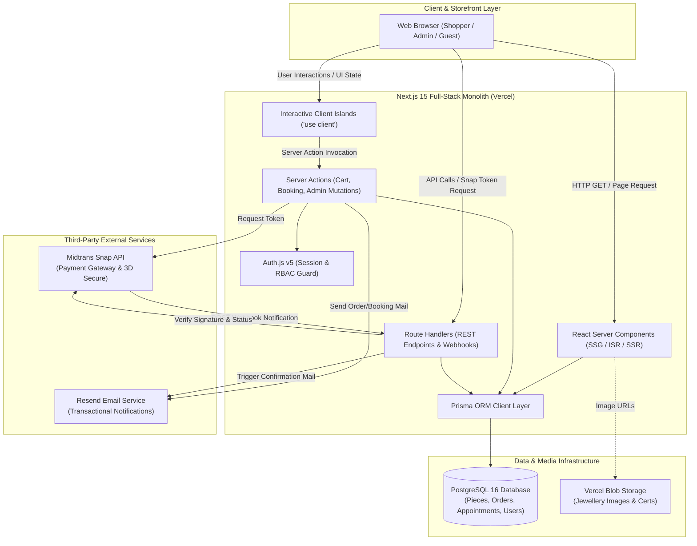
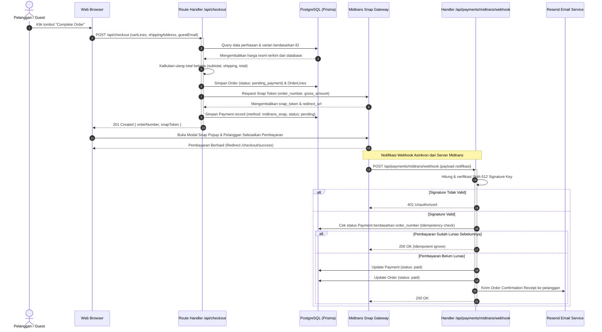
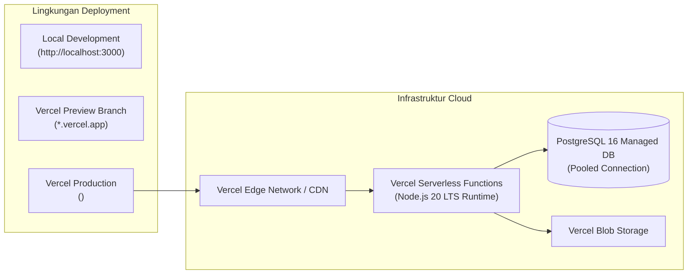

# ARCHITECTURE.md — Arsitektur Sistem & Alur Data

> **Tujuan:** Dokumen ini mendefinisikan rancangan arsitektur perangkat lunak untuk sistem Bifrost Jewellery. Dokumen ini memetakan batas modularitas monolit, topologi interaksi komponen, diagram alur transaksi checkout & pembayaran, struktur direktori kode, dan prinsip keamanan sistem.

---

## 1. Ikhtisar Arsitektur (Architectural Overview)

Sistem Bifrost Jewellery dibangun di atas pola **Modular Monolith** berkinerja tinggi menggunakan kerangka kerja full-stack **Next.js 15 (App Router)** yang terintegrasi langsung dengan database relasional **PostgreSQL 16**.

### Karakteristik Arsitektur Utama
- **Unified Full-Stack Runtime:** Lapisan antarmuka pengguna (Server Components) dan logika bisnis transaksi (Server Actions & Route Handlers) berada dalam satu repositori (*single codebase*), menghilangkan overhead jaringan antar-layanan microservices yang belum diperlukan.
- **Isolasi Logika Bisnis:** Setiap domain fungsional (Katalog, Checkout/Commerce, Booking Janji Temu, Panel Admin) diisolasi melalui modul terstruktur di `src/lib/` dengan batas kontrak data yang tegas.
- **Server-Driven Data Integrity:** Seluruh kalkulasi finansial, pengecekan ketersediaan stok berlian, dan validasi status pesanan dilakukan di lingkungan server yang aman (*server-side execution*).
- **External Specialized Services:** Layanan terspesialisasi dialihdayakan ke pihak ketiga terpercaya: Midtrans untuk payment gateway berstandar PCI-DSS, Resend untuk gateway email transaksional, dan Vercel Blob untuk distribusi aset media gambar.

---

## 2. Diagram Arsitektur Tingkat Tinggi (System Architecture Diagram)



---

## 3. Rincian Komponen Sistem (System Component Breakdown)

### 1. App Shell & Root Orchestration (`src/app/layout.tsx`)
Mengatur font loader sistem (`Cormorant Garamond`, `Inter`, `JetBrains Mono`), menginisialisasi smooth scroll inertia via Lenis, serta membungkus antarmuka dalam layout semantik quiet luxury.

### 2. Catalog & Discovery Engine (`/pieces`, `/collections`)
- Memanfaatkan strategi rendering **Incremental Static Regeneration (ISR)** dan **Static Site Generation (SSG)** untuk halaman beranda, daftar koleksi, dan halaman detail produk (`/pieces/[slug]`).
- Memungkinkan waktu muat mendekati instan dengan cache di Edge Network, sekaligus memperbarui data secara berkala saat inventori atau harga diperbarui di database.

### 3. Commerce & Checkout Engine (`/cart`, `/checkout`)
- Bersifat **Dynamic Rendering** untuk menjaga akurasi ketersediaan stok real-time.
- Mengelola keranjang belanja tamu (*guest cart*) dan keranjang pelanggan terdaftar.
- Menghitung ulang harga secara mutlak dari database, membuat pesanan dengan status `pending_payment`, dan berinteraksi dengan API Midtrans Snap untuk menerbitkan token transaksi.

### 4. Appointment Booking Engine (`/boutique`)
- Menyajikan slot waktu janji temu butik yang tersedia melalui endpoint query database teroptimasi.
- Mencegah terjadinya konflik reservasi ganda (*double booking*) melalui verifikasi waktu dan status janji temu.

### 5. In-App Admin Engine (`/admin`)
- Panel kontrol internal yang dilindungi oleh pemeriksaan otentikasi dan hak akses RBAC (`super_admin` dan `admin`).
- Mengelola katalog perhiasan, rincian berlian, pembaruan status pesanan, verifikasi transfer bank manual, dan penjadwalan janji temu.
- Seluruh mutasi admin dieksekusi melalui **Server Actions** yang divalidasi ketat dengan Zod.

### 6. Data Access Layer (`src/lib/db/prisma.ts`)
- Singleton client Prisma dengan penanganan pooling koneksi untuk lingkungan serverless PostgreSQL.

---

## 4. Diagram Alur Checkout & Notifikasi Webhook (Sequence Diagram)

Diagram berikut menjelaskan siklus lengkap pembelian perhiasan online, pembuatan pesanan, interaksi Midtrans Snap, dan penanganan webhook asinkron:



---

## 5. Struktur Direktori Proyek Lengkap (Directory Structure)

```
bifrost-jewellery-website/
├── prisma/
│   ├── schema.prisma                  # Definisi skema lengkap PostgreSQL 16
│   └── seed.ts                        # Script seeder kategori, butik, & data awal
├── public/                            # Favicon, ikon manifest, font statis
├── src/
│   ├── app/
│   │   ├── (store)/                   # Route group storefront publik
│   │   │   ├── page.tsx               # Beranda editorial
│   │   │   ├── collections/
│   │   │   │   ├── page.tsx           # Indeks seluruh koleksi
│   │   │   │   └── [slug]/page.tsx    # Halaman kurasi koleksi spesifik
│   │   │   ├── pieces/
│   │   │   │   ├── page.tsx           # Halaman katalog filterable 4Cs
│   │   │   │   └── [slug]/page.tsx    # Halaman detail perhiasan (PDP)
│   │   │   ├── boutique/
│   │   │   │   └── page.tsx           # Profil butik fisik & booking kalender
│   │   │   ├── cart/
│   │   │   │   └── page.tsx           # Ringkasan keranjang belanja
│   │   │   ├── checkout/
│   │   │   │   ├── page.tsx           # Alur checkout multi-step
│   │   │   │   └── success/page.tsx   # Halaman konfirmasi pembayaran sukses
│   │   │   ├── orders/
│   │   │   │   └── track/page.tsx     # Pelacakan pesanan publik (guest tracking)
│   │   │   ├── account/               # Area akun pelanggan (opsional)
│   │   │   └── journal/               # Artikel editorial & kisah craft
│   │   ├── admin/                     # Dashboard operasional internal (RBAC)
│   │   │   ├── layout.tsx             # Sidebar navigasi panel admin
│   │   │   ├── page.tsx               # Ringkasan metrik dashboard
│   │   │   ├── pieces/                # Manajemen perhiasan & varian
│   │   │   ├── orders/                # Pemrosesan pesanan & verifikasi transfer
│   │   │   ├── appointments/          # Manajemen kalender janji temu
│   │   │   └── inquiries/             # Penanganan permohonan konsultasi
│   │   ├── api/
│   │   │   ├── auth/[...nextauth]/    # Endpoint handler Auth.js v5
│   │   │   ├── pieces/                # REST GET list & filter perhiasan
│   │   │   ├── checkout/              # REST POST inisialisasi checkout
│   │   │   ├── appointments/          # REST POST reservasi & GET availability slots
│   │   │   ├── inquiries/             # REST POST formulir konsultasi
│   │   │   └── payments/
│   │   │       ├── midtrans/webhook/  # Handler webhook verifikasi notifikasi Midtrans
│   │   │       └── manual-transfer/   # Pengiriman referensi transfer bank manual
│   │   ├── layout.tsx                 # Root layout aplikasi (Font loader, Lenis)
│   │   └── globals.css                # Tailwind v4 semantik & CSS Variables
│   ├── components/
│   │   ├── ui/                        # Komponen atomik (button, input, badge, modal)
│   │   ├── layout/                    # Navbar, footer, editorial-container
│   │   └── modules/                   # Komponen fitur (product-gallery, filter-panel)
│   └── lib/
│       ├── actions/                   # Server Actions (cart, checkout, admin, booking)
│       ├── api/                       # Standard response envelope utilities
│       ├── auth/                      # Session & RBAC guard utilities
│       ├── db/                        # Singleton prisma.ts
│       ├── email/                     # Template React Email & pengirim Resend
│       ├── money.ts                   # Utilitas moneter IDR/USD minor units
│       ├── payments/                  # Client Midtrans Snap & verifikator signature
│       ├── types/                     # Definisi TypeScript domain entities
│       └── validation/                # Skema validasi Zod
```

---

## 6. Diagram & Topologi Deployment (Deployment Architecture)



- **Local:** Pengujian lokal menggunakan database PostgreSQL lokal atau container Docker.
- **Preview:** Setiap Pull Request ke GitHub memicu build pratinjau otomatis di Vercel untuk verifikasi visual dan uji coba integrasi.
- **Production:** Cabang `main` terhubung ke domain resmi `<TBD: domain>` dengan SSL otomatis dan Edge caching.

---

## 7. Arsitektur Keamanan Sistem (Security Architecture)

1. **Role-Based Access Control (RBAC):**
   - Rute panel admin (`/admin/**`) diproteksi melalui verifikasi sesi server-side menggunakan Auth.js v5.
   - Pengecekan peran dilakukan di tingkat Server Component dan Server Actions (*defense-in-depth*), bukan hanya mengandalkan Next.js Edge Middleware.
2. **Validasi Input Runtime Tanpa Pengecualian:**
   - Seluruh payload request wajib divalidasi menggunakan skema Zod sebelum diproses oleh database untuk mencegah serangan injeksi dan *malformed payloads*.
3. **Verifikasi Tanda Tangan Webhook & Idempotensi:**
   - Webhook Midtrans wajib memvalidasi hash SHA-512 `signature_key = SHA512(order_id + status_code + gross_amount + ServerKey)`.
   - Menggunakan kunci idempotensi untuk memastikan notifikasi ganda dari gateway tidak menyebabkan pembaruan status atau pengiriman email berulang.
4. **Isolasi PCI-DSS:**
   - Server aplikasi tidak pernah menerima, menyimpan, atau mentransmisikan nomor kartu kredit atau kode CVV pengguna. Seluruh interaksi pembayaran kartu kredit dialihkan ke antarmuka terlindung Midtrans Snap.
5. **Rate Limiting:**
   - Endpoint sensitif publik (formulir janji temu, formulir konsultasi, dan autentikasi admin) diproteksi dengan pembatasan frekuensi request (*rate limiting*) berbasis IP untuk mencegah serangan brute-force dan spamming.

---

## 8. Dokumen Terkait

- [DATABASE.md](./DATABASE.md) — Definisi skema database PostgreSQL
- [API_CONTRACT.md](./API_CONTRACT.md) — Spesifikasi antarmuka API dan webhook
- [CODING_RULES.md](./CODING_RULES.md) — Standar penulisan kode dan validasi
- [STACK.md](./STACK.md) — Daftar dependensi dan konfigurasi tumpukan teknologi
- [DECISIONS/001-nextjs15-app-router-postgres.md](./DECISIONS/001-nextjs15-app-router-postgres.md) — Alasan pemilihan Next.js 15 App Router & PostgreSQL
