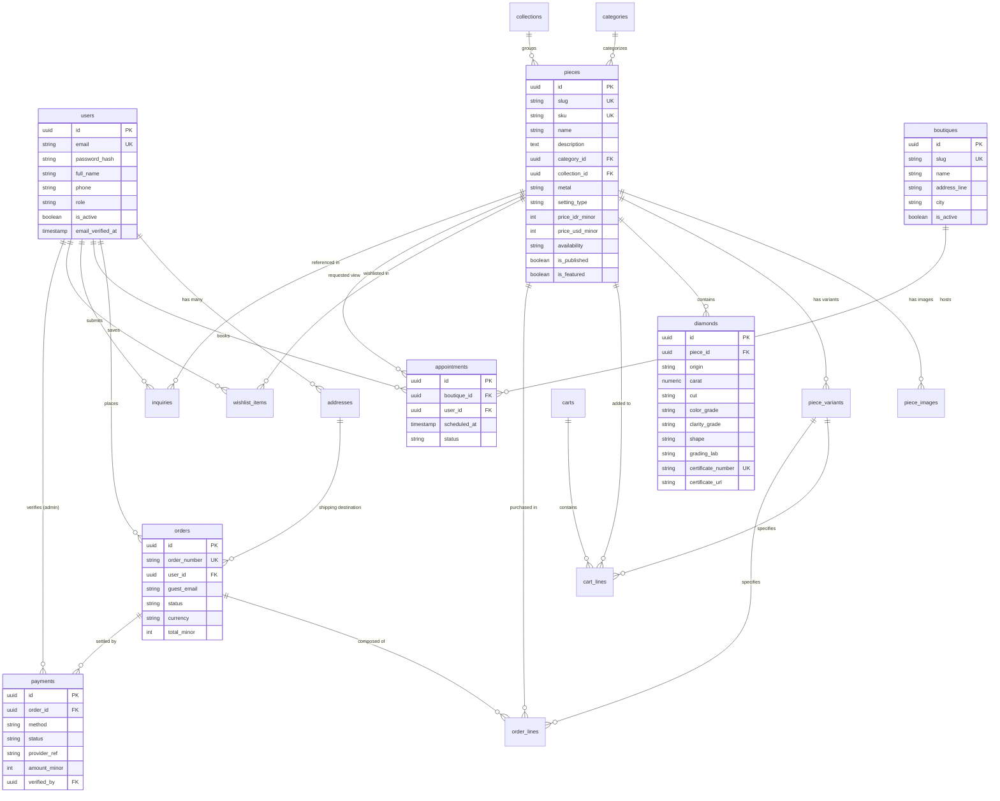

# DATABASE.md — Skema Database PostgreSQL & Model Prisma

> **Tujuan:** Dokumen ini mendefinisikan arsitektur basis data relasional untuk sistem Bifrost Jewellery. Dokumen ini memuat konvensi penamaan tabel/kolom, diagram relasi entitas (ERD), skema mendalam untuk 17 entitas data, indeks performa, aturan migrasi Prisma, dan strategi seeder.

---

## 1. Ikhtisar Basis Data (Database Overview)

- **Engine:** PostgreSQL 16
- **Karakter Set & Collation:** `UTF8` / `default`
- **Ekstensi Diperlukan:** `uuid-ossp` (atau native `gen_random_uuid()`) dan `citext` (pencarian email case-insensitive)
- **Object-Relational Mapping (ORM):** Prisma ORM (`@prisma/client` & `prisma`)
- **Manajemen Migrasi:** Prisma Migrate (`npx prisma migrate dev` & `npx prisma migrate deploy`)
- **Prinsip Moneter:** Seluruh nilai uang disimpan dalam bentuk bilangan bulat terkecil (*minor units/cents*): `price_idr_minor` (Rupiah bulat) dan `price_usd_minor` (sen dollar). Tidak menggunakan tipe data floating-point.

---

## 2. Konvensi Penamaan (Naming Conventions)

| Unsur Skema | Konvensi Penamaan | Contoh Nyata |
|---|---|---|
| **Nama Tabel** | Jamak (*plural*), huruf kecil, dipisahkan garis bawah (*snake_case*) | `pieces`, `order_lines`, `boutiques` |
| **Primary Key** | Selalu kolom `id` dengan tipe UUID v4 | `id UUID PRIMARY KEY DEFAULT gen_random_uuid()` |
| **Foreign Key** | Nama entitas tunggal diikuti akhiran `_id` | `category_id`, `piece_id`, `user_id` |
| **Kolom Boolean** | Menggunakan awalan predikat `is_` atau `has_` | `is_active`, `is_published`, `has_certificate` |
| **Kolom Waktu (Timestamps)** | Diakhiri dengan `_at`, tipe timestamp dengan zona waktu (`TIMESTAMPTZ`) | `created_at`, `updated_at`, `verified_at` |
| **Nilai Enum Database** | Huruf kecil dengan garis bawah (*snake_case*) | `pending_payment`, `lab_grown`, `gold_18k` |

---

## 3. Diagram Relasi Entitas (Entity-Relationship Diagram)

---

## 4. Skema Detail Tabel (Table Specifications)

### 4.1. Tabel `users`
Menyimpan data otentikasi pengelola (admin/super_admin) dan akun pelanggan opsional.

| Kolom | Tipe Data | Constraints | Deskripsi |
|---|---|---|---|
| `id` | `UUID` | `PRIMARY KEY, DEFAULT gen_random_uuid()` | Pengidentifikasi unik pengguna |
| `email` | `CITEXT` | `NOT NULL, UNIQUE` | Alamat email (case-insensitive) |
| `password_hash` | `VARCHAR(255)` | `NULLABLE` | Hash kata sandi bcrypt/argon2 (null untuk akun SSO/invited) |
| `full_name` | `VARCHAR(150)` | `NOT NULL` | Nama lengkap pengguna |
| `phone` | `VARCHAR(30)` | `NULLABLE` | Nomor telepon / WhatsApp aktif |
| `role` | `VARCHAR(30)` | `NOT NULL, DEFAULT 'customer'` | Enum: `'super_admin'`, `'admin'`, `'customer'` |
| `is_active` | `BOOLEAN` | `NOT NULL, DEFAULT true` | Status keaktifan akun pengguna |
| `email_verified_at`| `TIMESTAMPTZ`| `NULLABLE` | Waktu verifikasi email |
| `created_at` | `TIMESTAMPTZ` | `NOT NULL, DEFAULT NOW()` | Waktu pembuatan akun |
| `updated_at` | `TIMESTAMPTZ` | `NOT NULL, DEFAULT NOW()` | Waktu pembaruan akun |

### 4.2. Tabel `addresses`
Menyimpan buku alamat pelanggan untuk pengiriman perhiasan.

| Kolom | Tipe Data | Constraints | Deskripsi |
|---|---|---|---|
| `id` | `UUID` | `PRIMARY KEY, DEFAULT gen_random_uuid()` | ID unik alamat |
| `user_id` | `UUID` | `NULLABLE, REFERENCES users(id) ON DELETE CASCADE` | ID pengguna pemilik alamat |
| `recipient_name` | `VARCHAR(150)` | `NOT NULL` | Nama lengkap penerima kiriman |
| `phone` | `VARCHAR(30)` | `NOT NULL` | Nomor kontak penerima paket |
| `address_line1` | `VARCHAR(255)` | `NOT NULL` | Alamat lengkap (jalan, nomor gedung, RT/RW) |
| `address_line2` | `VARCHAR(255)` | `NULLABLE` | Rincian tambahan (nomor unit apartemen/patokan) |
| `city` | `VARCHAR(100)` | `NOT NULL` | Kota / Kabupaten |
| `province` | `VARCHAR(100)` | `NOT NULL` | Provinsi |
| `postal_code` | `VARCHAR(20)` | `NOT NULL` | Kode pos |
| `is_default` | `BOOLEAN` | `NOT NULL, DEFAULT false` | Penanda alamat pengiriman utama |
| `created_at` | `TIMESTAMPTZ` | `NOT NULL, DEFAULT NOW()` | Waktu penambahan alamat |
| `updated_at` | `TIMESTAMPTZ` | `NOT NULL, DEFAULT NOW()` | Waktu pembaruan alamat |

### 4.3. Tabel `categories`
Kategori perhiasan utama.

| Kolom | Tipe Data | Constraints | Deskripsi |
|---|---|---|---|
| `id` | `UUID` | `PRIMARY KEY, DEFAULT gen_random_uuid()` | ID kategori |
| `slug` | `VARCHAR(100)` | `NOT NULL, UNIQUE` | Slug URL (contoh: `rings`, `necklaces`, `bracelets`, `earrings`) |
| `name` | `VARCHAR(100)` | `NOT NULL` | Nama tampilan kategori |
| `description` | `TEXT` | `NULLABLE` | Deskripsi editorial kategori |
| `display_order` | `INTEGER` | `NOT NULL, DEFAULT 0` | Urutan penataan pada menu navigasi |
| `created_at` | `TIMESTAMPTZ` | `NOT NULL, DEFAULT NOW()` | Waktu dibuat |
| `updated_at` | `TIMESTAMPTZ` | `NOT NULL, DEFAULT NOW()` | Waktu diperbarui |

### 4.4. Tabel `collections`
Kurasi tematik koleksi perhiasan editorial.

| Kolom | Tipe Data | Constraints | Deskripsi |
|---|---|---|---|
| `id` | `UUID` | `PRIMARY KEY, DEFAULT gen_random_uuid()` | ID koleksi |
| `slug` | `VARCHAR(100)` | `NOT NULL, UNIQUE` | Slug koleksi (contoh: `solstice-edit`, `eternal-bands`) |
| `name` | `VARCHAR(150)` | `NOT NULL` | Nama koleksi |
| `tagline` | `VARCHAR(255)` | `NULLABLE` | Tagline editorial puitis |
| `description` | `TEXT` | `NULLABLE` | Narasi filosofi koleksi |
| `cover_image_url`| `TEXT` | `NULLABLE` | URL banner visual koleksi di Vercel Blob |
| `is_published` | `BOOLEAN` | `NOT NULL, DEFAULT false` | Status publikasi koleksi |
| `created_at` | `TIMESTAMPTZ` | `NOT NULL, DEFAULT NOW()` | Waktu dibuat |
| `updated_at` | `TIMESTAMPTZ` | `NOT NULL, DEFAULT NOW()` | Waktu diperbarui |

### 4.5. Tabel `pieces`
Entitas karya perhiasan jadi utama (*Pieces*).

| Kolom | Tipe Data | Constraints | Deskripsi |
|---|---|---|---|
| `id` | `UUID` | `PRIMARY KEY, DEFAULT gen_random_uuid()` | ID unik karya perhiasan |
| `slug` | `VARCHAR(150)` | `NOT NULL, UNIQUE` | Slug URL halaman detail perhiasan |
| `sku` | `VARCHAR(50)` | `NOT NULL, UNIQUE` | Kode unik inventori induk |
| `name` | `VARCHAR(200)` | `NOT NULL` | Nama resmi perhiasan |
| `description` | `TEXT` | `NOT NULL` | Deskripsi mendalam craftsmanship perhiasan |
| `category_id` | `UUID` | `NOT NULL, REFERENCES categories(id)` | Relasi ke kategori induk |
| `collection_id`| `UUID` | `NULLABLE, REFERENCES collections(id)`| Relasi ke koleksi editorial terkait |
| `metal` | `VARCHAR(50)` | `NOT NULL` | Enum: `'gold_18k'`, `'gold_14k'`, `'platinum'`, `'rose_gold_18k'` |
| `setting_type` | `VARCHAR(100)` | `NOT NULL` | Tipe dudukan (Solitaire, Bezel, Halo, Pavé) |
| `price_idr_minor`| `BIGINT` | `NOT NULL` | Harga resmi dalam IDR minor unit (Rupiah murni) |
| `price_usd_minor`| `INTEGER` | `NOT NULL` | Estimasi harga dalam USD minor unit (sen dollar) |
| `availability` | `VARCHAR(30)` | `NOT NULL, DEFAULT 'in_stock'` | Enum: `'in_stock'`, `'made_to_order'`, `'reserved'`, `'sold_out'` |
| `is_published` | `BOOLEAN` | `NOT NULL, DEFAULT false` | Status visibilitas di storefront |
| `is_featured` | `BOOLEAN` | `NOT NULL, DEFAULT false` | Penanda perhiasan pilihan untuk beranda |
| `created_at` | `TIMESTAMPTZ` | `NOT NULL, DEFAULT NOW()` | Waktu ditambahkan |
| `updated_at` | `TIMESTAMPTZ` | `NOT NULL, DEFAULT NOW()` | Waktu diperbarui |

### 4.6. Tabel `piece_images`
Galeri foto perhiasan multi-angle.

| Kolom | Tipe Data | Constraints | Deskripsi |
|---|---|---|---|
| `id` | `UUID` | `PRIMARY KEY, DEFAULT gen_random_uuid()` | ID gambar |
| `piece_id` | `UUID` | `NOT NULL, REFERENCES pieces(id) ON DELETE CASCADE` | Relasi ke perhiasan induk |
| `image_url` | `TEXT` | `NOT NULL` | URL publik gambar di Vercel Blob |
| `alt_text` | `VARCHAR(255)` | `NOT NULL` | Teks alternatif untuk aksesibilitas & SEO |
| `display_order` | `INTEGER` | `NOT NULL, DEFAULT 0` | Urutan penataan pada galeri gambar |
| `is_primary` | `BOOLEAN` | `NOT NULL, DEFAULT false` | Foto sampul utama pada kartu katalog |
| `created_at` | `TIMESTAMPTZ` | `NOT NULL, DEFAULT NOW()` | Waktu diunggah |

### 4.7. Tabel `piece_variants`
Varian ukuran cincin dan stok inventori fisik perhiasan.

| Kolom | Tipe Data | Constraints | Deskripsi |
|---|---|---|---|
| `id` | `UUID` | `PRIMARY KEY, DEFAULT gen_random_uuid()` | ID unik varian |
| `piece_id` | `UUID` | `NOT NULL, REFERENCES pieces(id) ON DELETE CASCADE` | Relasi ke perhiasan induk |
| `ring_size` | `VARCHAR(20)` | `NULLABLE` | Ukuran cincin (contoh: `'US 6'`, `'US 6.5'`, `'HK 12'`) |
| `stock` | `INTEGER` | `NOT NULL, DEFAULT 0` | Kuantitas stok fisik di brankas butik |
| `sku_suffix` | `VARCHAR(30)` | `NOT NULL` | Akhiran kode SKU spesifik varian |
| `created_at` | `TIMESTAMPTZ` | `NOT NULL, DEFAULT NOW()` | Waktu dibuat |
| `updated_at` | `TIMESTAMPTZ` | `NOT NULL, DEFAULT NOW()` | Waktu diperbarui |

### 4.8. Tabel `diamonds`
Spesifikasi batu mulia berlian yang tersemat pada perhiasan beserta sertifikat 4Cs.

| Kolom | Tipe Data | Constraints | Deskripsi |
|---|---|---|---|
| `id` | `UUID` | `PRIMARY KEY, DEFAULT gen_random_uuid()` | ID unik berlian |
| `piece_id` | `UUID` | `NOT NULL, REFERENCES pieces(id) ON DELETE CASCADE` | Relasi ke perhiasan pemilik berlian |
| `origin` | `VARCHAR(20)` | `NOT NULL` | Enum: `'natural'`, `'lab_grown'` |
| `carat` | `NUMERIC(5,2)` | `NOT NULL` | Berat karat berlian (misal: `1.25`) |
| `cut` | `VARCHAR(20)` | `NOT NULL` | Enum: `'excellent'`, `'very_good'`, `'good'`, `'fair'` |
| `color_grade` | `VARCHAR(10)` | `NOT NULL` | Derajat warna (contoh: `'D'`, `'E'`, `'F'`, `'G'`) |
| `clarity_grade` | `VARCHAR(10)` | `NOT NULL` | Tingkat kejernihan (contoh: `'FL'`, `'IF'`, `'VVS1'`, `'VS1'`) |
| `shape` | `VARCHAR(30)` | `NOT NULL` | Bentuk: `'round'`, `'oval'`, `'emerald'`, `'pear'`, `'princess'`, `'cushion'`, `'marquise'` |
| `grading_lab` | `VARCHAR(20)` | `NOT NULL` | Laboratorium penilaian: `'GIA'`, `'IGI'` |
| `certificate_number`| `VARCHAR(50)`| `NOT NULL, UNIQUE` | Nomor resmi laporan grading |
| `certificate_url` | `TEXT` | `NULLABLE` | Tautan verifikasi digital resmi lab grading |
| `created_at` | `TIMESTAMPTZ` | `NOT NULL, DEFAULT NOW()` | Waktu dibuat |
| `updated_at` | `TIMESTAMPTZ` | `NOT NULL, DEFAULT NOW()` | Waktu diperbarui |

### 4.9. Tabel `carts` & `cart_lines`
Menampung keranjang belanja pengguna terdaftar maupun pengunjung tamu (*guest*).

**Tabel `carts`:**
| Kolom | Tipe Data | Constraints | Deskripsi |
|---|---|---|---|
| `id` | `UUID` | `PRIMARY KEY, DEFAULT gen_random_uuid()` | ID keranjang |
| `user_id` | `UUID` | `NULLABLE, REFERENCES users(id) ON DELETE SET NULL` | ID pemilik jika sudah login |
| `session_token` | `VARCHAR(255)` | `NULLABLE, UNIQUE` | Token cookie sesi untuk pengunjung tamu |
| `created_at` | `TIMESTAMPTZ` | `NOT NULL, DEFAULT NOW()` | Waktu dibuat |
| `updated_at` | `TIMESTAMPTZ` | `NOT NULL, DEFAULT NOW()` | Waktu aktivitas terakhir |

**Tabel `cart_lines`:**
| Kolom | Tipe Data | Constraints | Deskripsi |
|---|---|---|---|
| `id` | `UUID` | `PRIMARY KEY, DEFAULT gen_random_uuid()` | ID baris keranjang |
| `cart_id` | `UUID` | `NOT NULL, REFERENCES carts(id) ON DELETE CASCADE` | Relasi ke keranjang induk |
| `piece_id` | `UUID` | `NOT NULL, REFERENCES pieces(id) ON DELETE CASCADE` | Perhiasan yang dipilih |
| `variant_id` | `UUID` | `NULLABLE, REFERENCES piece_variants(id)` | Varian ukuran perhiasan |
| `quantity` | `INTEGER` | `NOT NULL, DEFAULT 1` | Jumlah item yang dipesan |
| `created_at` | `TIMESTAMPTZ` | `NOT NULL, DEFAULT NOW()` | Waktu ditambahkan |
| `updated_at` | `TIMESTAMPTZ` | `NOT NULL, DEFAULT NOW()` | Waktu diperbarui |

### 4.10. Tabel `orders` & `order_lines`
Kontrak transaksi pembelian resmi.

**Tabel `orders`:**
| Kolom | Tipe Data | Constraints | Deskripsi |
|---|---|---|---|
| `id` | `UUID` | `PRIMARY KEY, DEFAULT gen_random_uuid()` | ID pesanan |
| `order_number` | `VARCHAR(50)` | `NOT NULL, UNIQUE` | Nomor referensi pesanan (contoh: `BJ-20261011-8821`) |
| `user_id` | `UUID` | `NULLABLE, REFERENCES users(id)` | Nullable untuk mendukung checkout tamu (*guest*) |
| `guest_email` | `CITEXT` | `NULLABLE` | Email kontak untuk tamu tanpa akun |
| `guest_name` | `VARCHAR(150)` | `NULLABLE` | Nama lengkap pemesan tamu |
| `guest_phone` | `VARCHAR(30)` | `NULLABLE` | Nomor kontak pemesan tamu |
| `status` | `VARCHAR(30)` | `NOT NULL, DEFAULT 'pending_payment'` | Enum: `'pending_payment'`, `'paid'`, `'processing'`, `'shipped'`, `'completed'`, `'cancelled'`, `'refunded'` |
| `currency` | `VARCHAR(10)` | `NOT NULL, DEFAULT 'IDR'` | Mata uang transaksi: `'IDR'` atau `'USD'` |
| `subtotal_minor` | `BIGINT` | `NOT NULL` | Subtotal item yang dihitung ulang di server |
| `shipping_minor` | `BIGINT` | `NOT NULL, DEFAULT 0` | Biaya asuransi pengiriman berlian |
| `total_minor` | `BIGINT` | `NOT NULL` | Total akhir tagihan yang wajib dibayar |
| `shipping_address_id`| `UUID` | `NULLABLE, REFERENCES addresses(id)` | Alamat tujuan pengiriman |
| `notes` | `TEXT` | `NULLABLE` | Catatan ukiran khusus (*engraving*) atau preferensi |
| `created_at` | `TIMESTAMPTZ` | `NOT NULL, DEFAULT NOW()` | Waktu pesanan dibuat |
| `updated_at` | `TIMESTAMPTZ` | `NOT NULL, DEFAULT NOW()` | Waktu status diperbarui |

**Tabel `order_lines`:**
| Kolom | Tipe Data | Constraints | Deskripsi |
|---|---|---|---|
| `id` | `UUID` | `PRIMARY KEY, DEFAULT gen_random_uuid()` | ID rincian pesanan |
| `order_id` | `UUID` | `NOT NULL, REFERENCES orders(id) ON DELETE CASCADE` | Relasi ke pesanan induk |
| `piece_id` | `UUID` | `NOT NULL, REFERENCES pieces(id)` | Perhiasan yang dibeli |
| `variant_id` | `UUID` | `NULLABLE, REFERENCES piece_variants(id)` | Varian ukuran cincin terpilih |
| `quantity` | `INTEGER` | `NOT NULL` | Kuantitas item |
| `unit_price_minor_idr`| `BIGINT` | `NOT NULL` | Snapshot harga satuan IDR saat transaksi |
| `unit_price_minor_usd`| `INTEGER` | `NOT NULL` | Snapshot harga satuan USD saat transaksi |
| `subtotal_minor_idr` | `BIGINT` | `NOT NULL` | Total harga baris IDR |
| `subtotal_minor_usd` | `INTEGER` | `NOT NULL` | Total harga baris USD |

### 4.11. Tabel `payments`
Pencatatan rincian pembayaran baik melalui gateway digital Midtrans maupun transfer bank manual.

| Kolom | Tipe Data | Constraints | Deskripsi |
|---|---|---|---|
| `id` | `UUID` | `PRIMARY KEY, DEFAULT gen_random_uuid()` | ID transaksi pembayaran |
| `order_id` | `UUID` | `NOT NULL, REFERENCES orders(id) ON DELETE CASCADE`| Relasi ke pesanan |
| `method` | `VARCHAR(30)` | `NOT NULL` | Enum: `'midtrans_snap'`, `'manual_transfer'` |
| `status` | `VARCHAR(30)` | `NOT NULL, DEFAULT 'pending'` | Enum: `'pending'`, `'awaiting_verification'`, `'paid'`, `'failed'`, `'expired'` |
| `provider_ref` | `VARCHAR(150)` | `NULLABLE` | ID transaksi atau token dari Midtrans |
| `amount_minor` | `BIGINT` | `NOT NULL` | Jumlah dana yang disetorkan |
| `proof_image_url`| `TEXT` | `NULLABLE` | URL bukti transfer bank yang diunggah pembeli |
| `verified_by` | `UUID` | `NULLABLE, REFERENCES users(id)` | Admin yang memverifikasi transfer manual |
| `verified_at` | `TIMESTAMPTZ` | `NULLABLE` | Waktu verifikasi manual disetujui |
| `created_at` | `TIMESTAMPTZ` | `NOT NULL, DEFAULT NOW()` | Waktu pembayaran diinisiasi |
| `updated_at` | `TIMESTAMPTZ` | `NOT NULL, DEFAULT NOW()` | Waktu pembaruan status |

### 4.12. Tabel `boutiques`
Lokasi butik fisik resmi Bifrost Jewellery.

| Kolom | Tipe Data | Constraints | Deskripsi |
|---|---|---|---|
| `id` | `UUID` | `PRIMARY KEY, DEFAULT gen_random_uuid()` | ID butik |
| `slug` | `VARCHAR(100)` | `NOT NULL, UNIQUE` | Slug URL butik (contoh: `jakarta-flagship`) |
| `name` | `VARCHAR(150)` | `NOT NULL` | Nama butik |
| `address_line` | `VARCHAR(255)` | `NOT NULL` | Alamat lengkap butik fisik |
| `city` | `VARCHAR(100)` | `NOT NULL` | Kota lokasi butik |
| `map_url` | `TEXT` | `NOT NULL` | Tautan sematan Google Maps |
| `phone` | `VARCHAR(30)` | `NOT NULL` | Nomor concierge butik |
| `opening_hours` | `VARCHAR(255)` | `NOT NULL` | Jam buka operasional |
| `is_active` | `BOOLEAN` | `NOT NULL, DEFAULT true` | Status butik menerima janji temu |
| `created_at` | `TIMESTAMPTZ` | `NOT NULL, DEFAULT NOW()` | Waktu dibuat |
| `updated_at` | `TIMESTAMPTZ` | `NOT NULL, DEFAULT NOW()` | Waktu diperbarui |

### 4.13. Tabel `appointments`
Reservasi sesi konsultasi tatap muka privat di butik fisik.

| Kolom | Tipe Data | Constraints | Deskripsi |
|---|---|---|---|
| `id` | `UUID` | `PRIMARY KEY, DEFAULT gen_random_uuid()` | ID janji temu |
| `user_id` | `UUID` | `NULLABLE, REFERENCES users(id)` | ID pengguna jika login |
| `guest_name` | `VARCHAR(150)` | `NOT NULL` | Nama lengkap tamu pengunjung |
| `guest_email` | `CITEXT` | `NOT NULL` | Email konfirmasi tamu |
| `guest_phone` | `VARCHAR(30)` | `NOT NULL` | Nomor kontak WhatsApp tamu |
| `boutique_id` | `UUID` | `NOT NULL, REFERENCES boutiques(id)` | Butik tujuan kunjungan |
| `scheduled_at` | `TIMESTAMPTZ` | `NOT NULL` | Waktu janji temu yang disepakati |
| `status` | `VARCHAR(30)` | `NOT NULL, DEFAULT 'requested'` | Enum: `'requested'`, `'confirmed'`, `'completed'`, `'cancelled'`, `'no_show'` |
| `piece_id` | `UUID` | `NULLABLE, REFERENCES pieces(id)` | Karya perhiasan spesifik yang ingin diinspeksi |
| `notes` | `TEXT` | `NULLABLE` | Catatan preferensi atau kebutuhan khusus tamu |
| `created_at` | `TIMESTAMPTZ` | `NOT NULL, DEFAULT NOW()` | Waktu reservasi diajukan |
| `updated_at` | `TIMESTAMPTZ` | `NOT NULL, DEFAULT NOW()` | Waktu status diperbarui |

### 4.14. Tabel `inquiries`
Formulir permohonan konsultasi perhiasan kustom (*bespoke*) atau pertanyaan permata khusus.

| Kolom | Tipe Data | Constraints | Deskripsi |
|---|---|---|---|
| `id` | `UUID` | `PRIMARY KEY, DEFAULT gen_random_uuid()` | ID formulir |
| `user_id` | `UUID` | `NULLABLE, REFERENCES users(id)` | ID pengguna jika login |
| `name` | `VARCHAR(150)` | `NOT NULL` | Nama lengkap pemohon |
| `email` | `CITEXT` | `NOT NULL` | Alamat email pemohon |
| `phone` | `VARCHAR(30)` | `NOT NULL` | Nomor telepon pemohon |
| `piece_id` | `UUID` | `NULLABLE, REFERENCES pieces(id)` | Referensi perhiasan terkait |
| `message` | `TEXT` | `NOT NULL` | Pesan detail kebutuhan kustomisasi |
| `status` | `VARCHAR(30)` | `NOT NULL, DEFAULT 'new'` | Enum: `'new'`, `'contacted'`, `'closed'` |
| `created_at` | `TIMESTAMPTZ` | `NOT NULL, DEFAULT NOW()` | Waktu diajukan |
| `updated_at` | `TIMESTAMPTZ` | `NOT NULL, DEFAULT NOW()` | Waktu status diperbarui |

### 4.15. Tabel `wishlist_items`
Daftar perhiasan favorit tersimpan oleh pengguna terdaftar.

| Kolom | Tipe Data | Constraints | Deskripsi |
|---|---|---|---|
| `id` | `UUID` | `PRIMARY KEY, DEFAULT gen_random_uuid()` | ID unik item |
| `user_id` | `UUID` | `NOT NULL, REFERENCES users(id) ON DELETE CASCADE`| Pengguna pemilik wishlist |
| `piece_id` | `UUID` | `NOT NULL, REFERENCES pieces(id) ON DELETE CASCADE` | Perhiasan yang disimpan |
| `created_at` | `TIMESTAMPTZ` | `NOT NULL, DEFAULT NOW()` | Waktu disimpan |

### 4.16. Tabel `faqs` & `testimonials`
Konten kurasi editorial publik.

**Tabel `faqs`:**
| Kolom | Tipe Data | Constraints | Deskripsi |
|---|---|---|---|
| `id` | `UUID` | `PRIMARY KEY, DEFAULT gen_random_uuid()` | ID pertanyaan |
| `category` | `VARCHAR(50)` | `NOT NULL` | Kelompok FAQ (`diamond_education`, `shipping`, `sizing`) |
| `question` | `TEXT` | `NOT NULL` | Kalimat pertanyaan |
| `answer` | `TEXT` | `NOT NULL` | Jawaban editorial resmi |
| `display_order` | `INTEGER` | `NOT NULL, DEFAULT 0` | Urutan penataan |
| `is_published` | `BOOLEAN` | `NOT NULL, DEFAULT true` | Status tayang |

**Tabel `testimonials`:**
| Kolom | Tipe Data | Constraints | Deskripsi |
|---|---|---|---|
| `id` | `UUID` | `PRIMARY KEY, DEFAULT gen_random_uuid()` | ID testimoni |
| `client_name` | `VARCHAR(150)` | `NOT NULL` | Nama klien nyata terverifikasi |
| `city` | `VARCHAR(100)` | `NULLABLE` | Kota asal klien |
| `piece_id` | `UUID` | `NULLABLE, REFERENCES pieces(id)` | Perhiasan yang dipesan |
| `quote` | `TEXT` | `NOT NULL` | Pernyataan pengalaman klien |
| `is_featured` | `BOOLEAN` | `NOT NULL, DEFAULT false` | Penanda tayang di beranda |
| `is_published` | `BOOLEAN` | `NOT NULL, DEFAULT true` | Status publikasi |

---

## 5. Tabel Indeks Performa & Constraint Unik

| Nama Indeks / Constraint | Tabel Sasaran | Kolom Sasaran | Alasan Performa / Keamanan |
|---|---|---|---|
| `idx_pieces_slug` | `pieces` | `slug` (UNIQUE) | Lookup instan halaman PDP `/pieces/[slug]` |
| `idx_pieces_category` | `pieces` | `category_id` | Filter cepat perhiasan berdasarkan kategori |
| `idx_pieces_collection`| `pieces` | `collection_id` | Agregasi karya dalam halaman kurasi koleksi |
| `idx_diamonds_cert_no` | `diamonds` | `certificate_number` (UNIQUE) | Verifikasi integritas keunikan sertifikat GIA/IGI |
| `idx_diamonds_filter` | `diamonds` | `(origin, shape, carat, cut)` | Optimasi performa multi-faceted diamond search |
| `idx_orders_number` | `orders` | `order_number` (UNIQUE) | Pencarian cepat pelacakan status pesanan publik |
| `idx_appointments_slot`| `appointments`| `(boutique_id, scheduled_at)` | Pencegahan konflik jadwal ganda (*double booking*) |
| `idx_wishlist_unique` | `wishlist_items` | `(user_id, piece_id)` (UNIQUE) | Mencegah duplikasi item dalam wishlist pengguna |

---

## 6. Aturan Migrasi Prisma (Prisma Migration Rules)

1. **Deklaratif via `schema.prisma`:** Seluruh perubahan skema wajib ditulis di berkas `prisma/schema.prisma`. Dilarang menjalankan perintah DDL langsung (`CREATE TABLE`, `ALTER TABLE`) secara manual di database staging/production.
2. **Perintah Migrasi:**
   - Development: `npx prisma migrate dev --name <deskripsi_singkat_perubahan>`
   - Production: `npx prisma migrate deploy`
3. **Penamaan Migrasi:** Gunakan nama deskriptif bahasa Inggris, misalnya `add_diamond_4cs_indexing` atau `create_orders_and_payments_tables`.

---

## 7. Strategi Seeder (`prisma/seed.ts`)

- Berkas `prisma/seed.ts` bertugas mengisi data awal esensial:
  1. Kategori baku: Rings, Necklaces, Bracelets, Earrings.
  2. Profil butik fisik resmi (`<TBD: alamat butik>`).
  3. FAQ dasar terkait edukasi 4Cs dan panduan ukuran cincin.
  4. Akun `super_admin` awal yang membaca kredensial aman dari variabel lingkungan `SEED_ADMIN_EMAIL` dan `SEED_ADMIN_PASSWORD` (hanya dijalankan di lingkungan lokal/development).
- **Larangan Keras:** DILARANG mengisi data palsu atau mengarang data batu mulia dan perhiasan fiktif tanpa konfirmasi kurator resmi.

---

## 8. Dokumen Terkait

- [GLOSSARY.md](./GLOSSARY.md) — Definisi nilai status enum dan entitas domain
- [API_CONTRACT.md](./API_CONTRACT.md) — Kontrak endpoint yang memanipulasi data
- [ARCHITECTURE.md](./ARCHITECTURE.md) — Arsitektur data layer dan Prisma client
- [CURRENT_STATE.md](./CURRENT_STATE.md) — Daftar penanda TBD skema data
