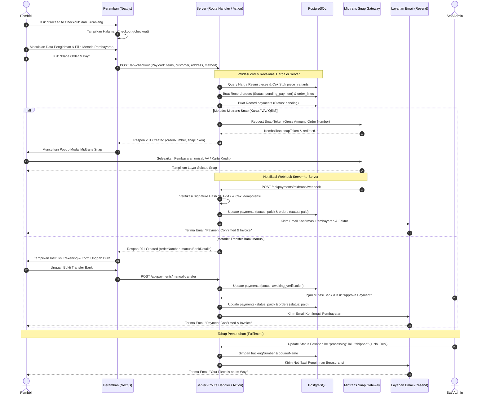

# 💳 FLOW — Alur Transaksi Keranjang & Checkout (CHECKOUT_FLOW)

> **Aktor:** Pembeli Tamu (*Guest*), Pelanggan Terdaftar, Midtrans Gateway, Staf Keuangan/Admin, Layanan Surel Resend  
> **Cakupan:** Keranjang Belanja → Formulir Pengiriman & Asuransi → Gerbang Pembayaran / Transfer Manual → Webhook & Verifikasi → Konfirmasi & Pemenuhan Pesanan.

---

## 1. Diagram Alur (Mermaid)

---

## 2. Tabel Langkah Pengguna & Sistem

| Langkah | Aksi Pengguna (User Action) | Respon Sistem (System Action) | State / Data Terkait |
|:---:|---|---|---|
| **1** | Membuka keranjang dan menekan tombol checkout. | Sistem mengarahkan ke `/checkout`, membaca cookie keranjang, dan menampilkan ringkasan pesanan. | Sesi keranjang terbaca. |
| **2** | Mengisi formulir data diri (nama, email, no HP) dan alamat pengiriman lengkap. | Sistem memvalidasi kelengkapan data via Zod di sisi klien secara instan dan menghitung biaya pengiriman aman perhiasan. | Subtotal + Asuransi dihitung. |
| **3** | Memilih metode pembayaran: Pembayaran Online (Midtrans) atau Transfer Bank Manual. | Sistem mengaktifkan konfigurasi rute pembayaran terkait dan memperbarui rincian instruksi. | Pilihan metode bayar tersimpan di form state. |
| **4** | Menekan tombol "Place Order & Pay". | Sistem mengeksekusi `POST /api/checkout`. Server mengambil harga resmi dari DB, memvalidasi stok, membuat record `orders` (`pending_payment`) dan `payments` (`pending`). | Entitas pesanan terbentuk di PostgreSQL. |
| **5A (Snap)** | Menyelesaikan pembayaran pada antarmuka Snap Midtrans. | Midtrans memproses transaksi dan mengirimkan webhook notifikasi asinkron ke server Bifrost. | Status pembayaran di gateway menjadi sukses. |
| **5B (Manual)** | Mentransfer dana dan mengunggah foto bukti bayar. | Server menerima berkas bukti ke Vercel Blob dan memperbarui status pembayaran menjadi `awaiting_verification`. | Bukti bayar tersimpan, menunggu verifikasi staf. |
| **6** | — (Sistem Otomatis / Aksi Admin). | Webhook Midtrans yang lolos verifikasi tanda tangan atau persetujuan manual oleh admin mengubah status order menjadi `paid`. | Status order: `paid`. Email terpicu via Resend. |
| **7** | Menerima email konfirmasi pembayaran resmi. | Pengguna dapat mengklik tombol "Track Order" dalam email untuk memeriksa status pengerjaan pesanan secara real-time. | Alur pelacakan aktif. |
| **8** | Staf workshop menyelesaikan inspeksi dan mengirimkan paket perhiasan. | Admin menginput nomor resi kurir berasuransi khusus di panel admin. Status pesanan berubah menjadi `shipped`. | Status order: `shipped`, nomor resi terekam. |

---

## 3. Penanganan Error & Kasus Tepi (Edge Cases)

| Skenario Kasus Tepi | Gejala / Kondisi | Solusi & Penanganan Sistem |
|---|---|---|
| **Perubahan Harga / Stok di Tengah Checkout** | Varian produk habis atau harga diperbarui sebelum pelanggan menekan bayar. | Server menolak permintaan dengan kode `409 Conflict`, membatalkan pembuatan order, dan meminta pelanggan memperbarui keranjang. |
| **Tanda Tangan Webhook Tidak Cocok** | Pihak tak dikenal mengirim request tiruan ke endpoint webhook Midtrans. | Sistem menghitung ulang hash SHA-512 dengan `MIDTRANS_SERVER_KEY`. Jika tidak identik, request langsung ditolak dengan `401 Unauthorized` tanpa menyentuh data pesanan. |
| **Webhook Terkirim Berulang Kali (Duplikasi)** | Midtrans mengirimkan notifikasi retry untuk transaksi yang telah diselesaikan. | Mekanisme idempoten memeriksa basis data: jika `payments.status` sudah bernilai `paid`, sistem mengembalikan `200 OK` seketika tanpa mengirim email berulang. |
| **Pelanggan Menutup Modal Snap Sebelum Bayar** | Jendela popup pembayaran ditutup oleh pengguna. | Pesanan tetap berada pada status `pending_payment` selama 24 jam. Pengguna dapat melanjutkan pembayaran melalui tautan di email pengingat pesanan. |
| **Pembayaran Kedaluwarsa (Expired)** | Pembeli tidak menyelesaikan pembayaran dalam batas waktu 24 jam. | Sistem penjadwalan / notifikasi expired dari Midtrans mengubah status order menjadi `cancelled` dan mengembalikan stok varian perhiasan. |
| **Bukti Transfer Tidak Terbaca / Palsu** | Pengguna mengunggah gambar buram atau nominal transfer tidak sesuai. | Staf keuangan menolak bukti bayar via panel admin (`action: 'reject'`). Sistem mengirimkan email pemberitahuan kepada pelanggan untuk mengunggah ulang bukti yang valid. |
