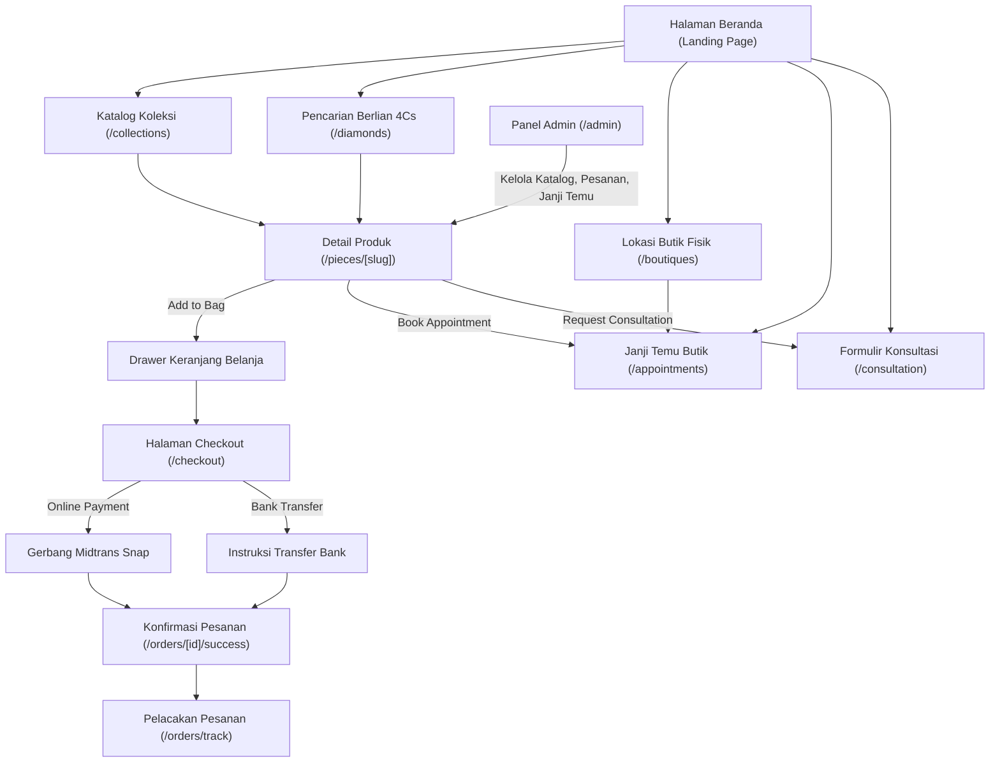

# 🌊 FLOWS — Indeks Alur Kerja Pengguna & Sistem

> **Proyek:** Bifrost Jewellery (`bifrost-jewellery-website`)  
> **Tujuan:** Direktori ini mendokumentasikan pemetaan perjalanan menyeluruh (*end-to-end user journeys*) bagi pelanggan publik, pembeli, tamu butik, dan staf operasional admin. Setiap dokumen memuat diagram alur Mermaid visual, tabel interaksi terperinci antara pengguna dan sistem, serta penanganan kasus tepi (*edge cases*) dan skenario kegagalan.

---

## 🗺️ Peta Alur Kerja (Flow Map)

Platform Bifrost Jewellery ditopang oleh 4 alur kerja utama:

| Alur Kerja | File Spesifikasi | Aktor Utama | Deskripsi Perjalanan |
|---|---|---|---|
| **Penelusuran & Eksplorasi** | [`BROWSING_FLOW.md`](./BROWSING_FLOW.md) | Pengunjung Publik, Kolektor | Menjelajahi halaman beranda → menelusuri katalog / filter berlian 4Cs → halaman detail produk → memilih jalur transaksi hibrida (Beli Online vs Konsultasi). |
| **Keranjang & Checkout** | [`CHECKOUT_FLOW.md`](./CHECKOUT_FLOW.md) | Pembeli (Guest / User) | Meninjau keranjang → mengisi alamat kirim & asuransi → memilih metode bayar (Midtrans Snap / Transfer Bank) → eksekusi bayar → webhook & email konfirmasi. |
| **Janji Temu Butik** | [`APPOINTMENT_FLOW.md`](./APPOINTMENT_FLOW.md) | Calon Klien Butik, Concierge | Memilih butik fisik → memilih tanggal & jam bebas konflik → mengisi data diri & preferensi karya → email konfirmasi & kalender (.ics) → kunjungan butik. |
| **Operasional Admin** | [`ADMIN_FLOW.md`](./ADMIN_FLOW.md) | Staf Admin, Super Admin | Otentikasi admin → ringkasan dashboard → manajemen inventaris katalog → persetujuan pembayaran manual → koordinasi janji temu & tindak lanjut konsultasi. |

---

## 🧭 Diagram Navigasi Utama Sistem

---

## 🔗 Dokumen Terkait

- [FEATURES/README.md](../FEATURES/README.md) — Daftar spesifikasi fitur terkait
- [ARCHITECTURE.md](../ARCHITECTURE.md) — Arsitektur sistem dan diagram sequence
- [API_CONTRACT.md](../API_CONTRACT.md) — Spesifikasi endpoint yang melayani alur
